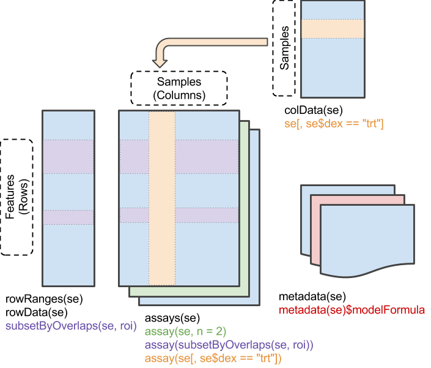

```{r, include = FALSE}
knitr::opts_chunk$set(echo = TRUE, fig.width=8, fig.height=6, fig.path = "fig/preprocessing-")
```

## Introduction

In this tutorial we'll explore the exploratory gene expression analysis and normalization using Bioconductor packages.

### R packages installation

We install R packages with the *install.packages* function.

```{r, eval=FALSE}
# install.packages(c("dplyr", "plyr", "corrplot", "ggfortify"))
```

### Bioconductor installation 

Bioconductor is a free, open-source, and open-development software project. It is based primarily on the statistical programming language R and provides packages for the analysis and interpretation of high-throughput genomic data.
For more information, see the [Bioconductor website](https://www.bioconductor.org/).

Installing Bioconductor requires the **BiocManager** package. 

```{r, eval=FALSE}
# if (!require("BiocManager", quietly = TRUE)) 
#   install.packages("BiocManager")
# Last version of Bioconductor
# BiocManager::install(version = "3.23")
```

### Bioconductor packages installation

To install core packages, necessary for all practical lectures, we use the `install()` function of **BiocManager** package.

```{r, eval=FALSE, message=FALSE}
# BiocManager::install(c("limma", "EDASeq", "edgeR"))
```

### Load packages

```{r, message=FALSE}
library(limma)
library(EDASeq)
library(edgeR)
library(dplyr)
library(plyr)
library(corrplot)
library(ggfortify)
library(SummarizedExperiment)
library(ggplot2)
library(tidyr)
```

## SummarizedExperiment

In this tutorial, we will use the lung adenocarcinoma (LUAD) dataset from The Cancer Genome Atlas (TCGA), a program that collects genomic mutations data from different types of tumors.

We will load the dataset previously saved in an RDS file.

```{r, message=FALSE}
luad <- readRDS("data/luad.rds")
luad
class(luad)
```

The object luad is a RangedSummarizedExperiment, a specialized subclass of **SummarizedExperiment**. The main difference is that a RangedSummarizedExperiment object contains genomic positions associated with its rows.

The **SummarizedExperiment** class is a data structure commonly used in the analysis of biological data, such as genomic or transcriptomic datasets. It is designed to store experimental measurements (e.g., a count matrix) together with associated metadata describing the features and the samples.



A **SummarizedExperiment** object contains several components useful for storing and analyzing high-throughput genomic data:

- `assays()` returns a list of gene expression matrices (e.g., raw and normalized counts). In the luad object, raw_count contains the raw count matrix with 60,606 genes (rows) and 539 samples (columns).

```{r, message=FALSE}
assays(luad)
# To visualize the raw count matrix we can use assay() function
class(assay(luad, "raw_count"))

# We visualize the first six genes and the first six samples
assay(luad, "raw_count")[1:6, 1:6]
```

- `colnames()` returns a vector containing the sample names;

```{r, message=FALSE}
colnames(luad)[1:6]
```

- `colData()` returns information about the samples, e.g., sample name, survival, sex, age, and other attributes. These data are stored in a DataFrame object.
Each row of the DataFrame corresponds to a sample (matching the columns of the SummarizedExperiment object), while each column represents a specific attribute of the samples;

```{r, message=FALSE}
class(colData(luad))
colData(luad)[1:6, 1:10]
# We use table() function to count living and deceased patients
table(luad$paper_Survival)
```

- `rownames()` returns a vector of gene IDs, specifically Ensembl stable identifiers. The number after the dot (e.g., .15 in ENSG00000000003.15) indicates the version number of the gene annotation, which Ensembl increments each time the gene's annotation is updated due to changes in genomic coordinates, transcript structure, or other refinements.

```{r, message=FALSE}
rownames(luad)[1:6]
rownames(luad) <- substr(rownames(luad), 1, 15)
```

- `rowData()` and `rowRanges()` return information about the genes, such as gene or transcript IDs. These data are stored in a DataFrame object. Additionally, `rowRanges()` provides the chromosome and genomic coordinates for each gene.

```{r, message=FALSE}
class(rowData(luad))

rowData(luad)[1:6, 1:10]
rowRanges(luad)[1:6, 1:10]
```

- `metadata()` contains other information

```{r}
metadata(luad)
```

For a more detailed description see [Bioconductor vignette](https://bioconductor.org/packages/release/bioc/vignettes/SummarizedExperiment/inst/doc/SummarizedExperiment.html).

For an understanding of the clinical variables regarding lung cancer staging, look at [IEO website](https://www.ieo.it/it/PER-I-PAZIENTI/Cure/Tumori-al-polmone/), while for the other variables, refer to the original work published in [Nature in 2014](https://www.nature.com/articles/nature13385) in particular to Figure 5 of the work.

### Patients selection

For the next analysis we select the patients who have the smoking status different to a missing value.

```{r}
summary(luad$paper_Smoking.Status)
# We remove NAs
luad <- luad[, !is.na(luad$paper_Smoking.Status)]
summary(luad$paper_Smoking.Status)
```

Also we remove the patients with "Not Available" information.

```{r}
luad <- luad[, luad$paper_Smoking.Status != "[Not Available]"]
luad
```

The dataset has been filtered and now contains 237 patients. The filtering step is important to remove all low-quality genes. In particular, we decide to keep only the genes with raw counts $\geq 10$.

```{r}
# There are 3467 genes whose sum is equal to zero
table(rowSums(assay(luad, "raw_count")) == 0)
table(rowSums(assay(luad, "raw_count")) >= 10)

# We keep the genes with the sum > 10
luad <- luad[rowSums(assay(luad, "raw_count")) >= 10, ]
luad
```

## Biological question

The aim of our analysis is to identify the transcriptional differences between the three LUAD subtypes: terminal respiratory unit (TRU), proximal-inflammatory (prox.-inflam), and proximal-proliferative (prox.-prolif). The subtype information is stored in the *paper_expression_subtype* variable.

```{r}
table(luad$paper_expression_subtype)
```

## Exploratory gene expression analysis

Every RNA-seq study begins with exploratory data analysis, where the data are visualized using boxplots, MD/MA plots, RLE plots, and principal component analysis (PCA). These visualizations help answer key questions:

  - Do different conditions or groups show distinct expression profiles?
  - Are there any outlier samples?

### Boxplot

We can start by visualizing the data using a boxplot. Before plotting, it is often necessary to transform the count matrix using a `log(counts + 1)` transformation. This transformation is important because:

  - RNA-seq samples often have different sequencing depths. Log transformation stabilizes the variance and makes the distributions more comparable across samples;
  - most genes have low counts, and a few have very high counts. Log transformation makes the data more balanced and easier to analyze;
  - adding 1 in log(counts + 1) allows us to transform zero counts, which would otherwise be undefined.

In R, we can apply this transformation using the `log1p()` function:

```{r}
raw_count <- assay(luad, "raw_count")

# For faster plotting, use only the first 20 samples
boxplot(raw_count[, 1:20])

# To make readable the boxplot on all we reduce the string of column names.
colnames(raw_count) <- substr(colnames(raw_count), 9, 29)

# Check whether there are any duplicate sample names.
table(duplicated(colnames(raw_count)))

colnames(luad) <- substr(colnames(luad), 9, 29)

boxplot(log1p(raw_count)[, 1:20])

col <- luad$paper_expression_subtype
levels(col)
levels(col) <- c(1:3)

boxplot(log1p(raw_count)[, 1:20], col = col, xlab = "Sample", ylab = "log1p expression", ylim = c(0, 20),  las = 2, cex.axis = 0.7)
legend("top", legend = c("prox.-inflam","prox.-prolif.", "TRU"), col = 1:3, pch = 20, cex = 0.7, ncol = 2)
```

We can recreate the boxplot using tidyverse and ggplot2 packages.

```{r, message=FALSE}
log1p <- log1p((raw_count)[, 1:20])

df <- as.data.frame(log1p)
df$gene <- rownames(df)

df_long <- pivot_longer(df, cols = -gene, names_to = "Sample", values_to = "Expression")

subtype <- colData(luad)$paper_expression_subtype[1:20]
names(subtype) <- colnames(raw_count)[1:20]
df_long$Subtype <- subtype[df_long$Sample]

# Plot with ggplot2
ggplot(df_long, aes(x = Sample, y = Expression, fill = Subtype)) +
  geom_boxplot(outlier.color = "black", outlier.shape = 1) +
  theme_bw() + scale_fill_manual(values = c("prox.-inflam" = "black", "prox.-prolif." = "red", "TRU" = "green")) +
  theme(axis.text.x = element_text(angle = 45, hjust = 1)) +
  labs(x = "Sample",
       y = "log1p(Expression)",
       fill = "Subtype")
```

### MD or MA charts

In addition to the boxplot we can use the MA or MD charts. 

To visualize the MA plot we can use the `plotMA()` function of **limma** package.

An MA plot visualizes differential expression results by plotting log2 fold change (M = log2(sample/virtual sample)) on the y-axis against mean normalized expression (A = average log counts) on the x-axis.

Most points should cluster around the horizontal line at M=0 (no change). Trends or biases away from this line indicate normalization issues or intensity-dependent effects. Outliers with large |M| values (>2) highlight highly differentially expressed genes.

```{r}
limma::plotMA(log1p(raw_count), main = "", xlab = "A", ylab = "M")
```

While, to visualize the MD plot we can use the `MDplot()` function of the **EDASeq** package. In particular, we choose a pair of experiments for comparison (6 and 7 samples). In this case, we use the raw count matrix.

```{r}
MDPlot(raw_count, c(6, 7))

MDPlot(raw_count, c(7, 6))
```

### RLE plot

Next, we visualize the data using an RLE (Relative Log Expression) plot before normalization, using the `plotRLE()` function from the **EDASeq** package.

RLE plots are useful to check the differences between samples. Ideally, the median of boxplot should be centered around zero. Deviations indicate technical variation or differences in library size that may need normalization.

```{r}
plotRLE(raw_count, outline = FALSE, las = 2,
        ylab = "RLE", main = "RLE of raw counts", col = col)
```

As expected the **RLE** graphs are very heterogeneous.

### Principal Component Analysis

Principal component analysis (PCA) is used to project a high-dimensional dataset (where the number of dimensions equals the number of genes or transcripts) onto few dimensions. In R, PCA can be computed using the built-in `prcomp()` function.

```{r}
pca <- prcomp(t(log1p(raw_count)))
summary(pca)$importance[, 1:20]
```

The proportion of variance explains how much of the variation in a dataset can be attributed to a specific component. For example, the proportion variance attributes to the first component is equal to 0.16.

```{r}
autoplot(pca)
```

The Principal Component matrix has the same dimensions as the original data matrix; however, many of the PCs may not be informative, so a reduction in the number of PCs is typically required. To do so, it is useful to examine the amount of variance explained by each new PC vector, using the scree plot criterion. The number of components to be chosen corresponds variance drops dramatically in size.

In this case we choose the first three components.

```{r}
screeplot(pca, type = c("lines"))
```

## Normalization

Normalization of RNA-seq read counts is an essential procedure that corrects for non-biological variation of samples due to library preparation, sequencing read depth, gene length, mapping bias and other technical issues. Normalization is composed of two main steps: within-sample normalization and between-sample normalization.

### Within samples normalization

The within-samples normalization is necessary for GC-content bias. For a more detailed description see [EDASeq vignette](https://bioconductor.org/packages/devel/bioc/vignettes/EDASeq/inst/doc/EDASeq.html#retrieving-gene-length-and-gc-content).

### Between samples normalization

Next, we compute the between normalization, using an R packages: **edgeR** package. We can utilize the `calcNormFactors` and `cpm` functions to estimate the normalizing factors for `RLE`, `TMM`, `upper quartile`, and `total count` normalizations.

```{r}
lbs <- calcNormFactors(raw_count, method = "RLE")
rle <- cpm(raw_count, lib.size = lbs * colSums(raw_count))

lbs <- calcNormFactors(raw_count, method = "TMM")
tmm <- cpm(raw_count, lib.size = lbs * colSums(raw_count))

lbs <- calcNormFactors(raw_count, method = "upperquartile")
uq <- cpm(raw_count, lib.size = lbs * colSums(raw_count))

tc <- cpm(raw_count)
```

#### Boxplot

Expression matrix visualization after normalization using boxplot.

```{r}
boxplot(log2(raw_count + 1), outline = FALSE,  las=2,
        ylab = "log(count+1)", main = "Before normalization", xaxt = 'n')

boxplot(log2(tc + 1), outline = FALSE, las = 2,
        ylab = "log(count+1)", main = "Boxplot Total count", xaxt='n')

boxplot(log2(rle + 1), outline=FALSE,  las=2,
        ylab = "log(count+1)", main = "Boxplot RLE", xaxt = 'n')

boxplot(log2(tmm + 1), outline=FALSE,  las=2,
        ylab = "log(count+1)", main = "Boxplot TMM", xaxt = 'n')

boxplot(log2(uq + 1), outline=FALSE,  las=2,
        ylab = "log(count+1)", main = "Boxplot Upper quartile", xaxt = 'n')
```

#### RLE plot

Expression matrix visualization after normalization using RLE plot.

```{r}
EDASeq::plotRLE(raw_count, outline = FALSE,  las=2, col=col,
        ylab = "RLE", main = "RLE before normalization", xaxt='n')

EDASeq::plotRLE(tc, outline = FALSE,  las=2, col=col,
        ylab = "RLE", main = "RLE total count", xaxt='n')

EDASeq::plotRLE(tmm, outline = FALSE,  las=2, col=col,
        ylab = "RLE", main = "RLE TMM", xaxt='n')

EDASeq::plotRLE(rle, outline = FALSE,  las=2, col=col,
        ylab = "RLE", main = "RLE RLE", xaxt='n')

EDASeq::plotRLE(uq, outline = FALSE,  las=2, col=col,
        ylab = "RLE", main = "RLE upper quartile", xaxt='n')
```

#### Principal component analysis

PCA analysis in the context of normalization performance assessment is useful only if  an *a priori* biological information on sample stratification is available. It is reasonable to select the normalization that better recognize the known stratification.

Now let's see the basic functions of R to make *PCA* and then we will use the data normalized with the *TMM* to explore the results. Finally we will use the *plotPCA* function to plot scores across all the normalizations.

```{r}
pca_tmm <- prcomp(t(log1p(tmm)))
tmp <- summary(pca_tmm)
tmp$importance[, 1:20]

autoplot(pca_tmm)

metadata <- colData(luad)

autoplot(pca_tmm, data = metadata, colour = "paper_expression_subtype") +
  scale_color_manual(values = c("prox.-inflam" = "black", "prox.-prolif." = "red", "TRU" = "green"))

screeplot(pca_tmm, type = c("lines"))  
```

## Save the data for the next tutorial

```{r}
save(list = c("luad", "tmm"), file = "normalization.RData")
```

