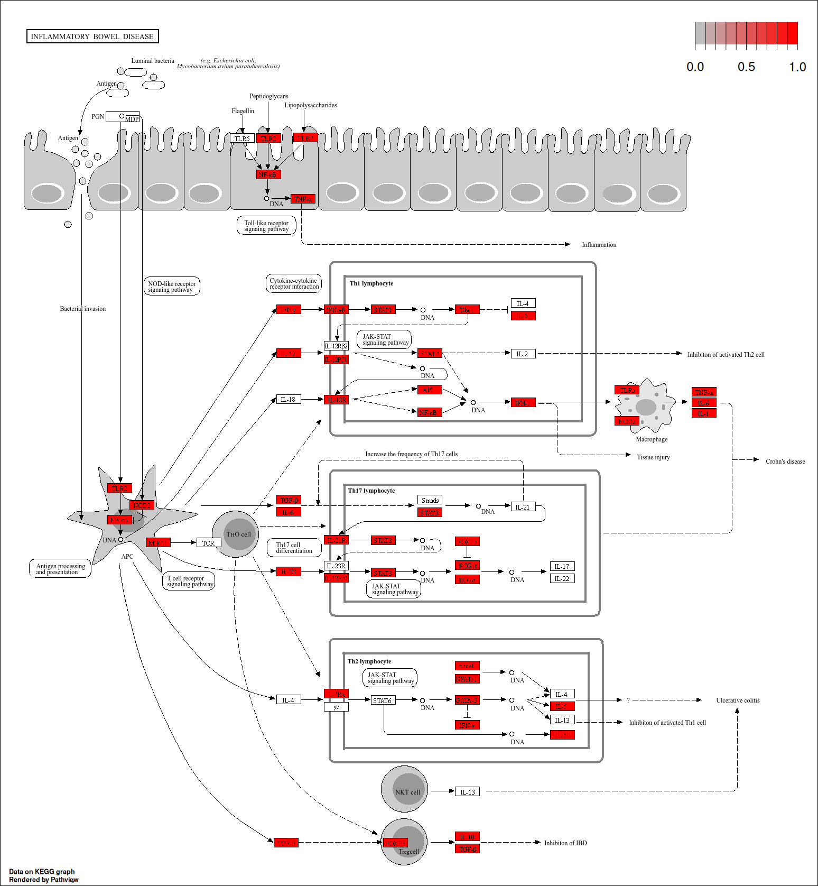

```{r, include = FALSE}
knitr::opts_chunk$set(echo = TRUE, message=FALSE, warning = FALSE, fig.width=8, fig.height=6, fig.path = "fig/Inference-")
```

## Introduction

After normalization we can proceed with the differential expression genes identification and enrichment analysis. Differentially expressed gene (DEG) identification is the process of finding genes whose expression levels differ significantly on average between biological conditions. The **edgeR** package will use to the identification.

```{r, message=FALSE}
library(dplyr)
library(plyr)
library(EDASeq)
library(limma)
library(edgeR)
library(genefilter)
library(ggplot2)
library(ggrepel)
library(DESeq2)
library(clusterProfiler)
library(pathview)
library(AnnotationDbi)
library(org.Hs.eg.db)
library(ReactomePA)
library(enrichplot)
library(ggnewscale)
library(ggupset)
library(ggridges)
```

We load the .RData object from the previous tutorial.

```{r}
load("normalization.RData")
```

The biological question is to identify the transcriptional differences between the two LUAD subtypes: proximal-inflammatory (prox.-inflam) and proximal-proliferative (prox.-prolif). The subtype information is stored in the `paper_expression_subtype` variable.

```{r}
table(luad$paper_expression_subtype)

# Remove the third category
luad_prox <- luad[, luad$paper_expression_subtype != "TRU"]
levels(luad_prox$paper_expression_subtype)
luad_prox$paper_expression_subtype <- as.character(luad_prox$paper_expression_subtype)
table(luad_prox$paper_expression_subtype)
```

## Exploring the mean-variance relationship

First we explore the *mean-variance* relationship on our dataset.

In RNA-seq data the variance is typically larger than the mean, a phenomenon called overdispersion. The distribution for over-dispersed counts is the Negative Binomial distribution (NB), where $Var(Y)=μ+ϕμ^2$ (quadratic relationship between the mean and the variance).

To estimate the dispersion we'll use **edgeR** package.

```{r, message=FALSE}
design <- model.matrix(~ paper_expression_subtype, data = colData(luad_prox))
head(design)
# Create a DGEList object
dge <- DGEList(assay(luad_prox, "raw_count"))
```

Then, scaling factors are computed using the `calcNormFactors()` function to convert the observed library sizes into normalized values.

The effective library sizes used in downstream analyses are calculated as `lib.size * norm.factors`, where `lib.size` contains the original library sizes and `norm.factors` is the vector of scaling factors computed by this function. The effective library sizes are incorporated into the model that estimates dispersion. The function `plotMeanVar()` in edgeR is used to visualize the relationship between gene expression levels (mean) and variability (variance).

```{r, message=FALSE}
dge <- calcNormFactors(dge, method="TMM")
dge <- estimateDisp(dge, design)
plotMeanVar(dge, show.raw.vars = TRUE, show.ave.raw.vars = F, NBline = TRUE, show.tagwise.vars = TRUE)
```

Each dot represents a gene. The x-axis shows the average expression level (mean), and the y-axis shows the variance. Both axes are on a log scale.

The black line represents the linear mean–variance relationship expected under a Poisson distribution, while the blue line represents the mean–variance trend under the negative binomial distribution. As gene expression increases, the variance also increases. Most points lie above the black line, indicating that the data are more variable than expected under a Poisson model. The blue line follows the cloud of points much more closely, suggesting that the negative binomial model provides a better fit.

The grey points represent the observed (raw) variances, while the dispersion estimates gene by gene are represented by the light blue dots.

## Identification of differentially expressed genes

The `glmFit()` function estimates the parameters of a generalized linear model (GLM). After normalization, the counts are effectively adjusted through scaling factors. To account for these normalized library sizes, an offset is included in the GLM: $log(E[Y|X]) = X\beta + O$, where $log(E[Y|X])$ is the link function for negative binomial distribution and $X\beta$ represents the linear predictor, and $O$ is the offset that incorporates the effective library sizes.

```{r, message=FALSE}
fit <- glmFit(dge, design)
fit$offset[,1:20]
```

Once the model parameters have been estimated, we can perform the differential expression test for each gene, using the `glmLRT()` function. By specifying `coef = 2` (prox.-proliferative vs prox.-inflammatory), the null hypothesis is $H0:\beta_2=0$, which tests whether the effect of this condition is significantly different from zero. Let's see the first ten differentially expressed genes sorted by log fold-change (*logFC*), using the `topTags()` function:
  
```{r, message=FALSE}
res <- glmLRT(fit, coef=2)
topTags(res, sort.by="logFC")
```

For each gene:
  
-   **logFC** measures how much the gene changes between the two conditions;
-   **logCPM** is the average expression
-   **LR** is the test statistic
-   **P-value** is the p-value
-   **FDR** is adjusted p-value (multiple testing)

Let's visualize the number of differentially expressed genes using a threshold of $FDR<0.05$:

```{r, message=FALSE}
tab <- topTags(res, n=Inf)
tab <- tab$table
head(tab)

deg <- tab[tab$FDR <0.05,]
dim(deg)
```

### DEGs exploration

#### MD plot

First, we visualize the MD plot, comparing the log-fold changes (**logFC**) with the average log counts per million (**logCPM**). Black points correspond to non-significant genes, while red and blue points indicate up- and down-regulated genes, respectively.

```{r, message=FALSE}
plotMD(res)
```

#### Volcano plot

A volcano plot is a graphical representation of **logFC** vs **-log10(PValue)** with the possibility to highlight some genes of interest

```{r, message=FALSE}
names <- rownames(deg)

tab$sign <- NA
tab$sign[tab$logFC < 0] <- "Down"
tab$sign[tab$logFC > 0] <- "Up"
tab$sign[tab$FDR >= 0.05] <- "NoSig"
tab$gene <- rownames(tab)

ggplot(tab, aes(x = logFC, y = -log10(PValue), color = sign)) + geom_point() + theme_classic() +
  scale_color_manual(values = c("Down" = "blue", "Up" = "red", "NoSig" = "black")) +
  geom_text_repel(data = tab[1:20, ], aes(label = gene), size = 2.5, max.overlaps = 20) 
```

#### P-value distribution

Last, we check the distribution of the *p-values*. In an unbiased situation we expect a peak on low values mixed with a uniform distribution. 
```{r, message=FALSE}
hist(tab$PValue, main="p-values distribution")
```

## Enrichment analysis

We will use the differentially expressed genes (DEGs) between the prox.prolif and prox.inflam conditions to perform enrichment analysis, identifying the biological processes, cellular functions, and metabolic pathways associated with these genes.

### ORA Method 

Over-representation analysis (ORA) is a method used to identify which biological pathways or functions are more represented in a list of genes than expected by chance, given the size of the universe (i.e., background genes).

To determine whether specific Gene Ontology (GO) categories or biological pathways are enriched in our DEG list, we will use the *enrichKEGG* function from the **clusterProfiler** package to analyse KEGG pathways, the *enrichPathway* function from the **ReactomePA** package to analyse Reactome pathways, and the *enrichGO* function from the **clusterProfiler** package to analyse Gene Ontology categories.

First, we need to store the reference universe in an object, i.e., all the quantified genes. Then, we need to convert the gene identifiers into Entrez IDs using the *mapIds* function. To do this, we need a genome-wide annotation package for humans that contains Entrez Gene identifiers: **org.Hs.eg.db**.

```{r, message=FALSE}
universe <- rownames(tab)
sign <- rownames(deg)

universe_entrez <- mapIds(org.Hs.eg.db, keys = universe, column = "ENTREZID", 
                          keytype = "ENSEMBL")  
head(universe_entrez)

sign_entrez <- mapIds(org.Hs.eg.db, keys = sign, column = "ENTREZID",
                      keytype = "ENSEMBL")
head(sign_entrez)
```

#### KEGG pathways

Using the Entrez ID vectors generated in the previous steps, we can calculate enrichment scores for all available KEGG pathways.

```{r, message=FALSE}
# To avoid the timeout
options(timeout = 300) 

ora_kegg <- enrichKEGG(gene = sign_entrez, universe = universe_entrez, organism = "hsa",
                 keyType = "ncbi-geneid", pvalueCutoff = 0.05, pAdjustMethod = "BH")
dim(ora_kegg)
ora_kegg@result[1:5,]
```

```{r}
# Barplot of number of genes involved
barplot(ora_kegg) 
# Useful when you want to distinguish between a term that is significant but 
# contains few of your genes vs. one where your DEGs dominate the pathway.
dotplot(ora_kegg) 
# Useful to see gene overlap between terms and identify multi-pathway genes
cnetplot(ora_kegg) 
# Reveals which genes are shared across multiple terms and which are unique to one pathway
heatplot(ora_kegg, showCategory = 10) 

# Similarity matrix
mat <- pairwise_termsim(ora_kegg)
# Enrichment Map, terms are nodes; edges connect terms that share genes
emapplot(mat) 

# Use this to understand the unique vs. shared gene membership across enriched categories.
upsetplot(mat, 8)
```

Let's give a look at the genes that belong to the pathway with ID **hsa05321**. We will use the **pathview** function from the *pathview* package:
  
```{r message=FALSE}
pathview(gene.data = sign_entrez, pathway.id = "hsa05321", species = "hsa")

```

#### Reactome pathways

```{r message=FALSE}
# To avoid the timeout
options(timeout = 300) 
ora_react <- enrichPathway(gene = sign_entrez, universe = universe_entrez,
                    organism = "human", pvalueCutoff = 0.05, pAdjustMethod = "BH")
ora_react@result[1:6, 1:6]
```

```{r}
barplot(ora_react)
dotplot(ora_react)
cnetplot(ora_react)
heatplot(ora_react, showCategory = 10)

mat <- pairwise_termsim(ora_react)
emapplot(mat)
upsetplot(mat, 5)
```

#### Gene Ontology categories

We run the same analyses using GO terms using the Biological Process (BP) the  Molecular function (MF) and the Cellular component (CC) categories:
  
```{r message=FALSE}
ora_go <- enrichGO(gene = sign_entrez, universe = universe_entrez,
                OrgDb = "org.Hs.eg.db", keyType = "ENTREZID", ont = "BP",
                pvalueCutoff = 0.05, pAdjustMethod = "BH", readable = TRUE)

dim(ora_go@result[1:10])
```

```{r}
barplot(ora_go)
upsetplot(ora_go, 5)
```

### GSEA (Gene Set Enrichment Analysis) method

GSEA (Gene Set Enrichment Analysis) does not require a binary DEG/non-DEG threshold.
Instead, it works on the full ranked gene list: all quantified genes are sorted by a continuous statistic (logFC), and the algorithm asks whether the members of a given gene set tend to cluster at the top (up-regulated) or bottom (down-regulated) of this ranking, beyond what is expected by chance. This makes it more sensitive to moderate changes across a pathway.

```{r}
logfc <- tab$logFC
names(logfc) <- universe_entrez

table(duplicated(names(logfc)))
logfc <- logfc[!duplicated(names(logfc))]
table(duplicated(names(logfc)))

sort_logfc <- sort(logfc, decreasing = TRUE)
```

Below we will see the results for KEGG and GO only but with  *gsePathway* function we can obtain the results for Reactome pathways.

#### KEGG pathway

We will use the *gseKEGG* function of **clusterProfiler** package to perform the analysis

```{r, message=FALSE}
gsea_kegg <- gseKEGG(geneList = sort_logfc, organism = "hsa", pvalueCutoff = 0.05)

# The key output is the Normalized Enrichment Score (NES)
gsea_kegg@result[1:10, 1:7] 
```

Visualize the distribution of the ranking statistics across the different gene sets.
  
```{r}
# Gene set enriched in down-regulated genes
gseaplot(gsea_kegg, geneSetID = "hsa03040")

#Gene set enriched in top-regulated genes
gseaplot(gsea_kegg, geneSetID = "hsa00053")

#Shows the distribution of the ranking statistic (logFC) for genes belonging to each enriched gene set. 
# Useful for interpreting the direction of enrichment in GSEA results.
ridgeplot(gsea_kegg, label_format = 50, showCategory = 20) 
```

#### GO categories

```{r}
gsea_go <- gseGO(geneList = sort_logfc, ont = "BP", OrgDb ='org.Hs.eg.db',
                 keyType = "ENTREZID", pAdjustMethod = "BH")
gsea_go@result[1:10, 1:6]
```

Visualize the distribution of the ranking statistics across the different gene sets.
  
```{r}
gseaplot(gsea_go, geneSetID = "GO:0006334")
ridgeplot(gsea_go, label_format = 50, showCategory = 20) 
dotplot(gsea_go)
```

```{r, eval=FALSE}
save("deg_enrichment.RData")
```

## Excercises

**Exercise 1**: Identify the differentially expressed genes between the TRU and prox.-inflam conditions.

**Exercise 2**: Repeat the hands-on lessons using a new dataset on Diffuse Large B-Cell Lymphoma (DLBCL).
